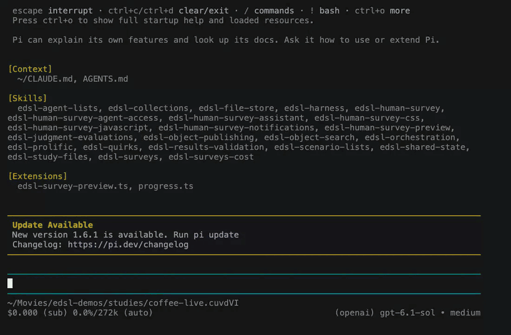

# 

[](https://pypi.org/project/edsl/) [](LICENSE) [](https://www.ycombinator.com/companies/expected-parrot) [](https://www.expectedparrot.com/cache-stats)

<!-- The cache badge groups 7–9 digits until expectedparrot/coopr#4586 deploys /api/remote-cache/badge.json with server-side number formatting. -->

[Expected Parrot](https://www.expectedparrot.com/)’s EDSL is an MIT-licensed Python library for surveys and simulations. You describe a study in natural language, and your coding agent uses EDSL to write and run it. The study design lives in code, so you can inspect it, ask the agent to change it, and run it again.

E[🦜] [Full EDSL documentation](https://docs.expectedparrot.com/en/latest/index) · [Academic papers using or citing EDSL](https://docs.expectedparrot.com/en/latest/papers)

## The best way to use EDSL is with your coding agent

Choose your agent and paste its setup prompt into the chat. Once EDSL is ready, describe the study you want to run. For example, “Make a three-question survey about coffee habits and show it here in the chat.”

[](https://www.expectedparrot.com/respond/human-surveys/f10115dd-8503-4024-ab4d-9d32b14e30fa)

<details>
<summary> Codex</summary>

Paste into Codex:

```text
Run `ep skills show edsl-harness` and follow its guidance. If the command or skill is missing, use https://raw.githubusercontent.com/expectedparrot/edsl/feat/edsl-harness-guidance/harnesses/README.md to set up EDSL for Codex.
```

Need Codex first? Run this in your project terminal.

```bash
curl -fsSL https://raw.githubusercontent.com/expectedparrot/edsl/feat/edsl-harness-guidance/harnesses/install.sh | bash -s -- codex --launch
```

</details>

<details>
<summary> Claude Code</summary>

Paste into Claude Code:

```text
Run `ep skills show edsl-harness` and follow its guidance. If the command or skill is missing, use https://raw.githubusercontent.com/expectedparrot/edsl/feat/edsl-harness-guidance/harnesses/README.md to set up EDSL for Claude Code.
```

Need Claude Code first? Run this in your project terminal.

```bash
curl -fsSL https://raw.githubusercontent.com/expectedparrot/edsl/feat/edsl-harness-guidance/harnesses/install.sh | bash -s -- claude-code --launch
```

</details>

<details>
<summary> GitHub Copilot CLI</summary>

Paste into GitHub Copilot CLI:

```text
Run `ep skills show edsl-harness` and follow its guidance. If the command or skill is missing, use https://raw.githubusercontent.com/expectedparrot/edsl/feat/edsl-harness-guidance/harnesses/README.md to set up EDSL for GitHub Copilot CLI.
```

Need GitHub Copilot CLI first? Run this in your project terminal.

```bash
curl -fsSL https://raw.githubusercontent.com/expectedparrot/edsl/feat/edsl-harness-guidance/harnesses/install.sh | bash -s -- copilot --launch
```

</details>

<details>
<summary> Cursor</summary>

Paste into Cursor:

```text
Run `ep skills show edsl-harness` and follow its guidance. If the command or skill is missing, use https://raw.githubusercontent.com/expectedparrot/edsl/feat/edsl-harness-guidance/harnesses/README.md to set up EDSL for Cursor.
```

To install and launch Cursor Agent in your terminal, run this command.

```bash
curl -fsSL https://raw.githubusercontent.com/expectedparrot/edsl/feat/edsl-harness-guidance/harnesses/install.sh | bash -s -- cursor --launch
```

</details>

<details>
<summary> OpenCode</summary>

Paste into OpenCode:

```text
Run `ep skills show edsl-harness` and follow its guidance. If the command or skill is missing, use https://raw.githubusercontent.com/expectedparrot/edsl/feat/edsl-harness-guidance/harnesses/README.md to set up EDSL for OpenCode.
```

Need OpenCode first? Run this in your project terminal.

```bash
curl -fsSL https://raw.githubusercontent.com/expectedparrot/edsl/feat/edsl-harness-guidance/harnesses/install.sh | bash -s -- opencode --launch
```

</details>

<details>
<summary> Pi</summary>

Paste into Pi:

```text
Run `ep skills show edsl-harness` and follow its guidance. If the command or skill is missing, use https://raw.githubusercontent.com/expectedparrot/edsl/feat/edsl-harness-guidance/harnesses/README.md to set up EDSL for Pi.
```

Need Pi first? Run this in your project terminal.

```bash
curl -fsSL https://raw.githubusercontent.com/expectedparrot/edsl/feat/edsl-harness-guidance/harnesses/install.sh | bash -s -- pi --launch
```

</details>

<details>
<summary> Google Antigravity CLI</summary>

Paste into Google Antigravity CLI:

```text
Run `ep skills show edsl-harness` and follow its guidance. If the command or skill is missing, use https://raw.githubusercontent.com/expectedparrot/edsl/feat/edsl-harness-guidance/harnesses/README.md to set up EDSL for Google Antigravity CLI.
```

Need Google Antigravity CLI first? Run this in your project terminal.

```bash
curl -fsSL https://raw.githubusercontent.com/expectedparrot/edsl/feat/edsl-harness-guidance/harnesses/install.sh | bash -s -- antigravity --launch
```

</details>

<details>
<summary> Vercel fx</summary>

Paste into Vercel fx:

```text
Run `ep skills show edsl-harness` and follow its guidance. If the command or skill is missing, use https://raw.githubusercontent.com/expectedparrot/edsl/feat/edsl-harness-guidance/harnesses/README.md to set up EDSL for Vercel fx.
```

Need Vercel fx first? Run this in your project terminal.

```bash
curl -fsSL https://raw.githubusercontent.com/expectedparrot/edsl/feat/edsl-harness-guidance/harnesses/install.sh | bash -s -- fx --launch
```

</details>

<details>
<summary> Meta Muse Code</summary>

Paste into Meta Muse Code:

```text
Run `ep skills show edsl-harness` and follow its guidance. If the command or skill is missing, use https://raw.githubusercontent.com/expectedparrot/edsl/feat/edsl-harness-guidance/harnesses/README.md to set up EDSL for Meta Muse Code.
```

Need Meta Muse Code first? Run this in your project terminal.

```bash
curl -fsSL https://raw.githubusercontent.com/expectedparrot/edsl/feat/edsl-harness-guidance/harnesses/install.sh | bash -s -- muse --launch
```

</details>

<details>
<summary> Mistral Vibe</summary>

Paste into Mistral Vibe:

```text
Run `ep skills show edsl-harness` and follow its guidance. If the command or skill is missing, use https://raw.githubusercontent.com/expectedparrot/edsl/feat/edsl-harness-guidance/harnesses/README.md to set up EDSL for Mistral Vibe.
```

Need Mistral Vibe first? Run this in your project terminal.

```bash
curl -fsSL https://raw.githubusercontent.com/expectedparrot/edsl/feat/edsl-harness-guidance/harnesses/install.sh | bash -s -- vibe --launch
```

</details>

The installer sets up EDSL once for use across your projects. [Setup options](harnesses/README.md#installing-the-agent-from-a-terminal) · [Amp, Kiro CLI, and Cline setup](harnesses/README.md#amp-kiro-cli-and-cline)

## Build and Edit Surveys

Ask your coding agent to make a coffee survey, then tell it to skip the brew question for people who don’t drink coffee. The updated questionnaire shows exactly where a “No” answer leads.


## Run with LLM-Simulated Personas

One Expected Parrot E[🦜] API key gives you access to models from OpenAI, Anthropic, and Google through hosted inference. Here, each model answers the same survey as a night-shift nurse, a barista, and a tea drinker. Compare all nine interviews in one results table.


## Collect Responses from Real People

Send the same survey to people by link or email invitation. This demo follows one test response from the browser form to the answers saved in EDSL Results.



## Key features

| What you want to do | What EDSL lets you do |
| --- | --- |
| Design a questionnaire | Mix rankings, matrices, budget allocations, scales, and open text. Branch on an answer, quote it in a later question, or ask a follow-up about each item someone lists. [Question catalog](https://docs.expectedparrot.com/en/latest/questions) · [Survey logic](https://docs.expectedparrot.com/en/latest/guides/survey_logic) |
| Run a controlled experiment | Cross two versions of a message with the same personas and models. Compare ratings by wording, respondent profile, and model while holding the other inputs fixed. [Experimental conditions](https://docs.expectedparrot.com/en/latest/guides/experimental_conditions) |
| Compare AI models | Ask hundreds of models the same questions with one Expected Parrot key, use your own provider keys, or connect a local model server. Compare which records the models disagree on. [Model access](https://docs.expectedparrot.com/en/latest/api_keys) · [Model comparisons](https://docs.expectedparrot.com/en/latest/guides/model_comparisons) |
| Field the same study with people | Send a URL or email invitations, or recruit through Prolific with eligibility filters and a cost estimate. Retrieve responses for analysis alongside the simulations. [Human studies](https://docs.expectedparrot.com/en/latest/guides/human_studies) · [Prolific](https://docs.expectedparrot.com/en/latest/prolific) |
| Conduct qualitative interviews | Put an AI-led interview next to a rating question. Have the interviewer probe the reason for the rating and retain the conversation transcript with the structured answers. [Interview guide](https://docs.expectedparrot.com/en/latest/guides/human_interviews) |
| Label data and check agreement | Apply a codebook to documents, images, or spreadsheet rows. Give people the same labeling task, match answers by record ID, and inspect where people and models disagree. [Data labeling](https://docs.expectedparrot.com/en/latest/guides/data_labeling) · [Human validation](https://docs.expectedparrot.com/en/latest/research/human_validation) |
| Trace and analyze answers | Inspect the prompt, model, persona, and scenario behind an answer. Query results with SQL, take selected columns into pandas, or export a CSV. [Results guide](https://docs.expectedparrot.com/en/latest/results) |
| Rerun and share a study | Reuse cached model responses, save the survey and its inputs as a job, and share it so a collaborator can rerun the same design. [Caching](https://docs.expectedparrot.com/en/latest/cache) · [Saving and sharing](https://docs.expectedparrot.com/en/latest/guides/saving_objects) |

<details>
<summary>More study designs and tools</summary>

| What you want to do | What EDSL lets you do |
| --- | --- |
| Test for order effects | In simulated interviews, shuffle choices while keeping “Other” last, reverse a rating scale, or draw questions from a pool. The results record what each interview received. [Randomization guide](https://docs.expectedparrot.com/en/latest/surveys) |
| Pilot an instrument | Ask models to flag ambiguous wording before fielding a survey, or try two labeling instructions on identical records and see which answers change. [Survey pretesting](https://docs.expectedparrot.com/en/latest/research/pretesting) · [Prompt sensitivity](https://docs.expectedparrot.com/en/latest/research/prompt_sensitivity) |
| Elicit population forecasts | Turn a questionnaire into a meta-survey. Describe a population and ask models to predict the share that would choose each option, then compare those forecasts with observed responses. [Meta-surveys](https://docs.expectedparrot.com/en/latest/meta_surveys) |
| Score many items against a rubric | Batch choice and rating questions about the same material with a supported judgment model. Inspect the probability it assigned to each option alongside its selected answer. [Evaluations](https://docs.expectedparrot.com/en/latest/evaluations) |
| Study how models use tools | Give a supported model web search in a direct provider run. Inspect the search events and citations returned by the provider alongside the answer. [Provider tools](https://docs.expectedparrot.com/en/latest/language_models#provider-tools) |
| Manage larger runs | Estimate cost before launching, submit a background job, close the notebook, and retrieve the results when it finishes. [Costs](https://docs.expectedparrot.com/en/latest/costs) · [Background jobs](https://docs.expectedparrot.com/en/latest/guides/background_jobs) |
| Coordinate participants across stages *(experimental)* | Have several participants propose ideas independently, then give a reviewer their proposals to choose from. Assign steps to people, models, or scripted respondents. [Respondent workflows](https://docs.expectedparrot.com/en/latest/workflows) |
| Simulate markets or enforce quotas *(experimental)* | Let interviews read and update shared state. Reserve the last place in a survey group or collect bids and determine who wins a second-price auction. [Survey quotas](https://docs.expectedparrot.com/en/latest/shared-state/survey-quotas) · [Auction example](https://docs.expectedparrot.com/en/latest/shared-state/second-price-auction) |

</details>

For Python setup and a worked example, see the [installation guide](https://docs.expectedparrot.com/en/latest/installation) and [first survey tutorial](https://docs.expectedparrot.com/en/latest/starter_tutorial).
