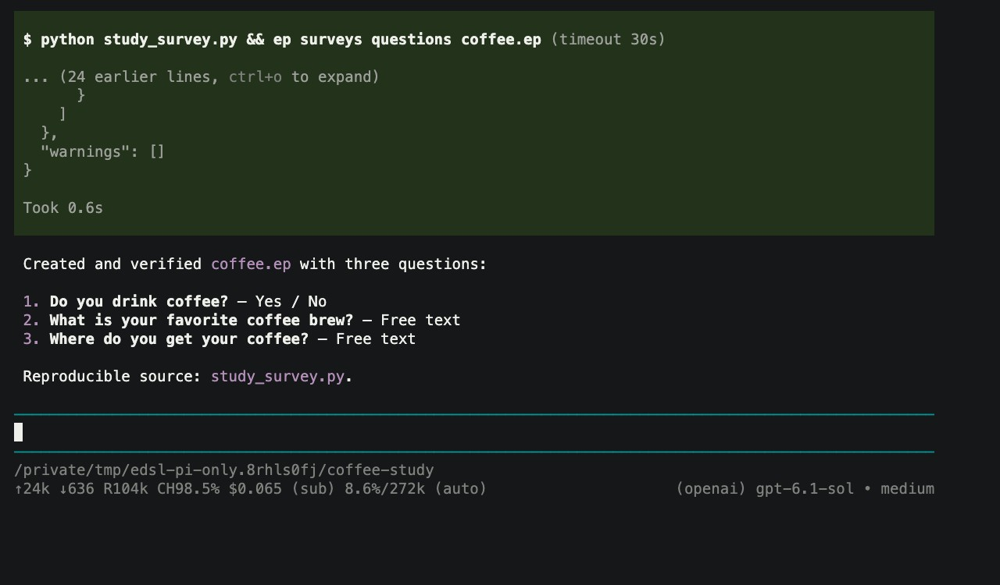

# 

EDSL is a Python library for surveys and simulations. You describe a study in natural language, and your coding agent uses EDSL to write and run it. The study design lives in code, so you can inspect it, ask the agent to change it, and run it again.

## The best way to use EDSL is with your coding agent

Choose your agent and paste its setup prompt into the chat. Once EDSL is ready, describe the study you want to run. For example, “Make a three-question survey about coffee habits and show me the preview.”

<details>
<summary> Codex</summary>

Paste into Codex:

```text
Run `ep skills show edsl-harness` and follow its guidance. If the command or skill is missing, use https://raw.githubusercontent.com/expectedparrot/edsl/feat/edsl-harness-guidance/harnesses/README.md to set up EDSL for Codex.
```

Need Codex first? Run this in your project terminal.

```bash
curl -fsSL https://raw.githubusercontent.com/expectedparrot/edsl/feat/edsl-harness-guidance/harnesses/install.sh | bash -s -- codex --launch
```

</details>

<details>
<summary> Claude Code</summary>

Paste into Claude Code:

```text
Run `ep skills show edsl-harness` and follow its guidance. If the command or skill is missing, use https://raw.githubusercontent.com/expectedparrot/edsl/feat/edsl-harness-guidance/harnesses/README.md to set up EDSL for Claude Code.
```

Need Claude Code first? Run this in your project terminal.

```bash
curl -fsSL https://raw.githubusercontent.com/expectedparrot/edsl/feat/edsl-harness-guidance/harnesses/install.sh | bash -s -- claude-code --launch
```

</details>

<details>
<summary> OpenCode</summary>

Paste into OpenCode:

```text
Run `ep skills show edsl-harness` and follow its guidance. If the command or skill is missing, use https://raw.githubusercontent.com/expectedparrot/edsl/feat/edsl-harness-guidance/harnesses/README.md to set up EDSL for OpenCode.
```

Need OpenCode first? Run this in your project terminal.

```bash
curl -fsSL https://raw.githubusercontent.com/expectedparrot/edsl/feat/edsl-harness-guidance/harnesses/install.sh | bash -s -- opencode --launch
```

</details>

<details>
<summary> Pi</summary>

Paste into Pi:

```text
Run `ep skills show edsl-harness` and follow its guidance. If the command or skill is missing, use https://raw.githubusercontent.com/expectedparrot/edsl/feat/edsl-harness-guidance/harnesses/README.md to set up EDSL for Pi.
```

Need Pi first? Run this in your project terminal.

```bash
curl -fsSL https://raw.githubusercontent.com/expectedparrot/edsl/feat/edsl-harness-guidance/harnesses/install.sh | bash -s -- pi --launch
```

</details>

<details>
<summary> Google Antigravity CLI</summary>

Paste into Google Antigravity CLI:

```text
Run `ep skills show edsl-harness` and follow its guidance. If the command or skill is missing, use https://raw.githubusercontent.com/expectedparrot/edsl/feat/edsl-harness-guidance/harnesses/README.md to set up EDSL for Google Antigravity CLI.
```

Need Google Antigravity CLI first? Run this in your project terminal.

```bash
curl -fsSL https://raw.githubusercontent.com/expectedparrot/edsl/feat/edsl-harness-guidance/harnesses/install.sh | bash -s -- antigravity --launch
```

</details>

<details>
<summary> Vercel fx</summary>

Paste into Vercel fx:

```text
Run `ep skills show edsl-harness` and follow its guidance. If the command or skill is missing, use https://raw.githubusercontent.com/expectedparrot/edsl/feat/edsl-harness-guidance/harnesses/README.md to set up EDSL for Vercel fx.
```

Need Vercel fx first? Run this in your project terminal.

```bash
curl -fsSL https://raw.githubusercontent.com/expectedparrot/edsl/feat/edsl-harness-guidance/harnesses/install.sh | bash -s -- fx --launch
```

</details>

The installer sets up EDSL once for use across your projects. [Setup options](harnesses/README.md#installing-the-agent-from-a-terminal)

[](docs/assets/demos/edsl-agent-demo.mp4?raw=true)

[Watch Pi build a survey and add a skip rule (40-second terminal recording)](docs/assets/demos/edsl-agent-demo.mp4?raw=true)

## Key features

| Feature | What you can do |
| --- | --- |
| Question types | Ask respondents to choose one or more options, rate items in a matrix, rank choices, allocate a budget, or enter a number or free-text answer. [Question catalog](https://docs.expectedparrot.com/en/latest/questions) |
| Survey logic | Branch or stop based on an answer, pipe it into a later question, or repeat a group of follow-ups for each item a respondent lists. [Survey logic guide](https://docs.expectedparrot.com/en/latest/guides/survey_logic) |
| Model access | Use one Expected Parrot API key to access hundreds of AI models, or use your own provider keys. |
| Model comparison | Give several models the same survey and compare answers by model, scenario, or simulated persona. |
| Human surveys | Share a survey by URL or send email invitations and collect responses. |
| AI interviews | Give an AI interviewer a research question and let it ask participants follow-up questions. |
| Data labeling | Apply the same questions to each document, image, or row in a dataset. |
| Results | Filter answers, export them to CSV, and reuse cached model responses when repeating an analysis. |

For Python setup and a worked example, see the [installation guide](https://docs.expectedparrot.com/en/latest/installation) and [first survey tutorial](https://docs.expectedparrot.com/en/latest/starter_tutorial).
